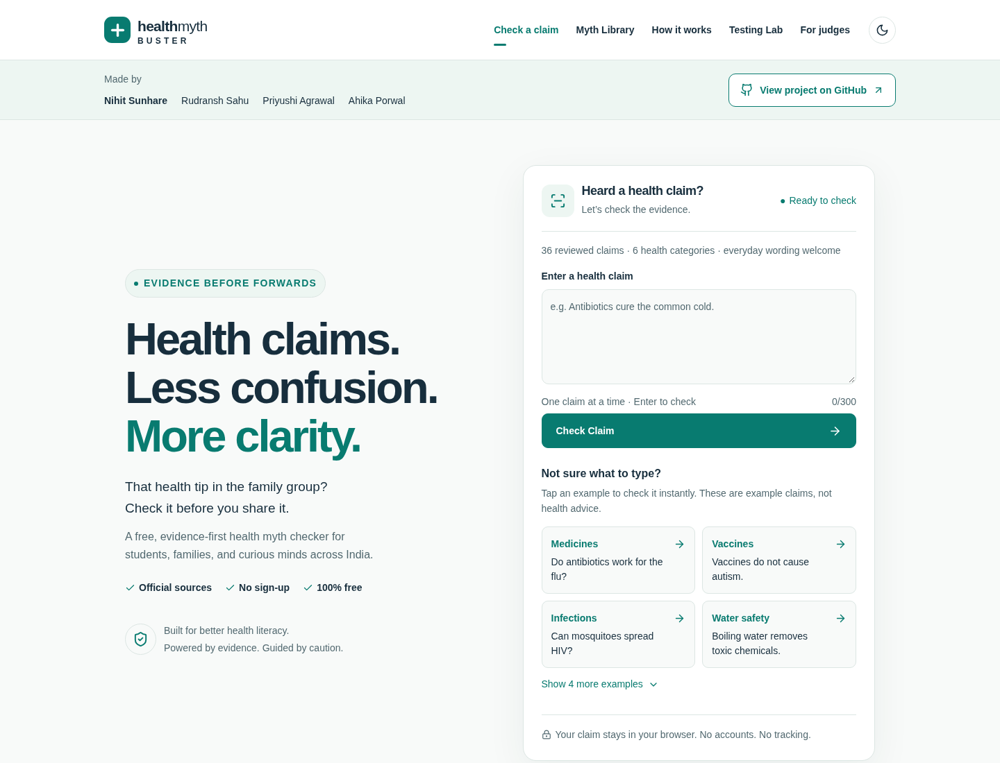

<div align="center">


# Health Myth Buster

### Health claims. Less confusion. More clarity.

Check that health tip before you forward it.<br />
A free, evidence-first health-literacy tool for students and families across India.

[](https://github.com/nihitdev/health-myth-buster/actions/workflows/ci.yml)
[](LICENSE)
[](package.json)
[](tsconfig.json)
[](vite.config.ts)
[](src/styles.css)

[](SOURCE_AUDIT.md)
[](ARCHITECTURE.md)
[](#how-it-works)

**HCL Jigsaw 7.0 · Round 2 · Grade 6**<br />
AI Revolution & Digital Futures

[Get started](#get-started) · [Try these claims](#try-these-claims) · [Evidence audit](SOURCE_AUDIT.md) · [Contribute](#contributing)

</div>

<br />

<div align="center">
  
  <p><sub>Actual local application screenshot. Light and dark themes are available.</sub></p>
</div>

## Evidence before forwards

Health advice travels fast in family chats and social feeds. Health Myth Buster helps people pause, inspect a claim, and read the evidence behind the answer.

Type a claim or tap an example. The tool checks its reviewed local database and returns one of three verdicts:

| Verdict        | What it means                                                            |
| :------------- | :----------------------------------------------------------------------- |
| **TRUE**       | The matched statement is supported by its cited evidence.                |
| **FALSE**      | The matched statement is contradicted by its cited evidence.             |
| **UNVERIFIED** | The tool cannot reliably check the statement, its wording, or its scope. |

Every matched result includes a plain-English explanation and **at least two relevant official source links**. Unknown claims are never automatically labeled false. Every answer ends with **“Always ask a doctor.”**

> **Honest scope:** 36 evidence-reviewed entries across 6 health categories, with 31 separate candidates awaiting review. Our target is 50 reviewed claims. Development source review is not independent clinical validation, and the app cannot diagnose diseases or prescribe treatment.

## What you can do

| Feature                     | Inside the app                                                                                                                             |
| :-------------------------- | :----------------------------------------------------------------------------------------------------------------------------------------- |
| **Check a claim**           | Type, paste, or press Enter to check a short health statement.                                                                             |
| **Start with one click**    | Pick from 8 examples covering medicines, vaccines, infections, water safety, everyday health, tobacco, broad wording and an unknown topic. |
| **Explore the evidence**    | Search the Myth Library and filter by category or verdict. Open the original source pages.                                                 |
| **See the reasoning**       | Expand the match explanation to understand which rule produced the result.                                                                 |
| **Run genuine evaluations** | Save expected and actual answers locally, add feedback, compare before/after runs and export CSV or JSON.                                  |
| **Present to judges**       | Use three demonstration screens powered by the actual matching engine.                                                                     |
| **Read comfortably**        | Responsive layouts, readable text, keyboard controls, live result announcements, light/dark themes and reduced-motion support.             |

**Private by design:** claims are processed in your browser. No account, analytics, backend, paid API, or API key is required. Test records and theme preferences stay on that device; reading external source pages requires internet. Hosting providers may retain standard access logs.

## Get started

### 1. Clone the project

```sh
git clone https://github.com/nihitdev/health-myth-buster.git
cd health-myth-buster
```

### 2. Install and run

Use **Node.js 22.18+** and npm. Development was verified with Node 26; CI uses Node 24.

```sh
npm ci
npm run dev
```

Open **[localhost:5173](http://localhost:5173)**. No environment variables or service credentials are needed.

### 3. Build for production

```sh
npm run build
npm run preview
```

Vite writes the static production site to `dist/`. Use the preview URL printed in the terminal to inspect the build.

## Try these claims

These examples run through the real engine; they are not participant-testing outcomes.

| Type or paste                            | Expected tool verdict                                                          |
| :--------------------------------------- | :----------------------------------------------------------------------------- |
| `Do antibiotics work for the flu?`       | **FALSE**                                                                      |
| `Vaccines do not cause autism.`          | **TRUE**                                                                       |
| `Can mosquitoes spread HIV?`             | **FALSE**                                                                      |
| `Exercise improves mental health.`       | **TRUE**                                                                       |
| `Boiling water removes toxic chemicals.` | **FALSE**                                                                      |
| `Antibiotics cure common illness`        | **UNVERIFIED** — asks for a more specific illness and offers related evidence. |
| `Blue notebooks prevent headaches.`      | **UNVERIFIED** — outside the reviewed evidence library.                        |

Related evidence helps you explore a topic; it does **not** verify an unknown original statement.

## How it works

```text
Enter a claim or select an example
                ↓
Normalize text and controlled language variations
                ↓
Check scope, wording, polarity and reviewed patterns
                ↓
Find one reliable match in the reviewed database
                ↓
TRUE / FALSE + explanation + official sources
                or
UNVERIFIED + clarification and related evidence, when available
```

The matcher recognizes bounded spelling variations, word forms such as _cures → cure_, phrases such as _works for_, and clear questions about one statement. Explicitly reviewed negative phrasings have their own verdicts. Other negation, conflicting interpretations, unsupported extra content, and personal treatment requests trigger abstention.

**This is a transparent, deterministic, rule-based prototype. It does not use machine learning, an LLM, embeddings, or an AI API.** A rule score measures wording compatibility, not medical certainty. Read [ARCHITECTURE.md](ARCHITECTURE.md) for the matching flow and its limits.

## Evidence you can inspect

- **36 published entries** have source-content review notes and at least two relevant official references each.
- **31 pending candidates** have no assigned verdict or invented review date and are excluded from verified matching.
- Sources include WHO, CDC, NHS, UNAIDS, ANACS, MoHFW and NCI. References do not imply affiliation or endorsement.
- Review dates record the development evidence check; they are separate from publisher dates.
- Negated variants are supported phrasings, not extra entries used to inflate the database count.

Read the [source audit](SOURCE_AUDIT.md) to inspect URLs, relevant evidence sections, reviewed variants and unresolved candidates. Follow [MYTH_DATABASE.md](MYTH_DATABASE.md) before proposing a new claim. Pending entries never count toward the target of 50 reviewed claims.

## Quality checks

Latest recorded verification: **247 unit tests** and **8 desktop/mobile browser tests** passed, along with linting and the production build. These are engineering checks, not a claim of medical accuracy or completed human testing. The workflow badge above shows the current GitHub Actions status.

| Command                 | Purpose                                                                                                     |
| :---------------------- | :---------------------------------------------------------------------------------------------------------- |
| `npm test`              | Run the Vitest matching, safeguard, database-integrity and evaluation-utility tests.                        |
| `npm run lint`          | Check TypeScript and React code with ESLint.                                                                |
| `npm run build`         | Run strict TypeScript checks and build the production site.                                                 |
| `npm run test:e2e`      | Test browser interactions, accessibility, mobile layouts, local persistence, exports and practice previews. |
| `npm run audit:sources` | Regenerate the audit from existing review notes. This does **not** reverify medical evidence.               |

Install the browser once before running end-to-end tests:

```sh
npx playwright install chromium
npm run test:e2e
```

The browser suite builds the production bundle and starts its own preview server on **port 5174**, leaving the development server on port 5173 available. Browser checks use Chromium desktop and mobile emulation. Physical-device, Safari and screen-reader checks still need human review.

### Real people, real evaluation

The Testing Lab starts with **zero saved evaluations**. One-click examples are labeled practice previews and do not count toward accuracy. Genuine evaluations require the tester to enter their own claim, check the expected answer independently, assess correctness and explicitly save the record.

**Accuracy = Correct answers / Total tested claims × 100**

Use [TESTING_GUIDE.md](TESTING_GUIDE.md) to organize four students, at least five other participants, and at least 20 claims in their own words. Do not report planned testing as completed results or enter personal health information.

## Find your way around

| Route                      | Purpose                                                                    |
| :------------------------- | :------------------------------------------------------------------------- |
| `/`                        | Claim checker, one-click examples and an introduction to the method.       |
| `/library`                 | Searchable evidence library with category and verdict filters.             |
| `/about`                   | Methodology, limitations and privacy.                                      |
| `/testing`                 | Practice previews, local evaluations, exports and before/after comparison. |
| `/presentation` or `/demo` | Three working demonstration screens for judges.                            |

<details>
<summary><strong>Project structure</strong></summary>

```text
health-myth-buster/
├── src/
│   ├── components/       # Checker, result cards, sources and example cards
│   ├── pages/            # Home, library, methodology, testing and presentation
│   ├── data/             # Reviewed claims, pending candidates and examples
│   ├── engine.ts         # Deterministic matching and conservative safeguards
│   ├── language.ts       # Controlled normalization and wording rules
│   ├── storage.ts        # Local test records and CSV/JSON exports
│   └── styles.css        # Responsive design, themes and accessibility styles
├── e2e/                  # Playwright browser and accessibility checks
├── scripts/              # Source-audit report generation
├── public/               # Website icon and Netlify route fallback
├── docs/images/          # Actual website preview for this README
├── .github/workflows/    # Automated quality checks
└── vercel.json           # Static deployment and SPA route configuration
```

</details>

## Deploy for free

**Deployment-ready; no public deployment URL is currently confirmed.**

| Setting                    | Vercel                          | Netlify                      |
| :------------------------- | :------------------------------ | :--------------------------- |
| Framework                  | Vite                            | Vite                         |
| Build command              | `npm run build`                 | `npm run build`              |
| Output / publish directory | `dist`                          | `dist`                       |
| Environment variables      | None                            | None                         |
| Direct-route support       | Included `vercel.json` rewrites | Included `public/_redirects` |

Import this repository into your hosting account and complete the deployment. For a publicly accessible Vercel production site, ensure deployment protection does not require visitors to log in.

Before sharing a public URL:

1. Confirm the deployment succeeded.
2. Open the production URL on another device in a signed-out or private browser.
3. Check a reviewed claim, an unknown claim, and the source links.
4. Open and refresh `/library` and `/presentation` directly.
5. Confirm mobile usability, test export and access without login.

Add the real production URL only after these checks succeed.

## Project documentation

| Guide                                         | What it covers                                                            |
| :-------------------------------------------- | :------------------------------------------------------------------------ |
| [Architecture](ARCHITECTURE.md)               | Components, matching flow, privacy and storage.                           |
| [Myth database](MYTH_DATABASE.md)             | Schema, evidence standards and the review process.                        |
| [Source audit](SOURCE_AUDIT.md)               | Published evidence and unresolved candidates.                             |
| [Testing guide](TESTING_GUIDE.md)             | Genuine participant evaluation and improvement cycles.                    |
| [Verification report](VERIFICATION_REPORT.md) | Recorded engineering checks and remaining manual work.                    |
| [Presentation notes](PRESENTATION_NOTES.md)   | Suggested PPT content and demonstration sequence.                         |
| [Video script](VIDEO_SCRIPT.md)               | Four speaking parts with placeholders for real contributions and results. |

## Made by

<div align="center">

**Nihit Sunhare** · Rudransh Sahu · Priyushi Agrawal · Ahika Porwal

Built for **HCL Jigsaw 7.0**<br />
AI Revolution & Digital Futures

</div>

## Contributing

Ideas, accessibility improvements, bug reports and carefully sourced claim proposals are welcome.

1. Open an [issue](https://github.com/nihitdev/health-myth-buster/issues) or propose a focused pull request.
2. For evidence changes, follow [MYTH_DATABASE.md](MYTH_DATABASE.md), read the official sources, and add regression cases.
3. Run the relevant quality checks and explain the behavior your change improves.

Never submit personal health details, fabricated citations, invented review dates or fake participant results. Do not promote an unreviewed claim simply to increase the database count.

## License

This project’s original code and documentation are available under the [MIT License](LICENSE). Linked third-party source material remains subject to its own terms.

---

<div align="center">

**Evidence before forwards.**<br />
Always ask a doctor.

[Back to top](#health-myth-buster)

</div>
